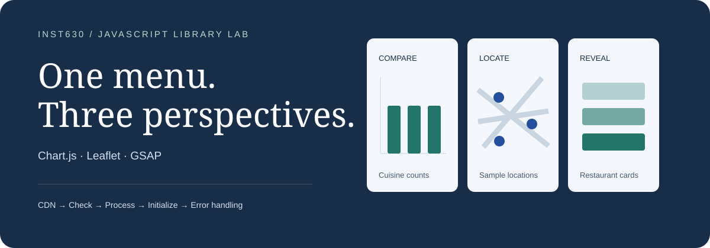
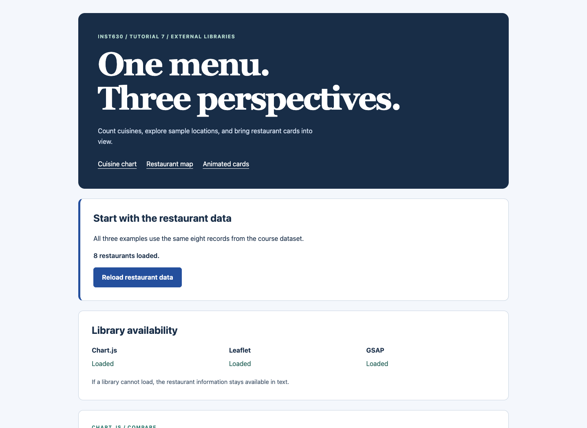
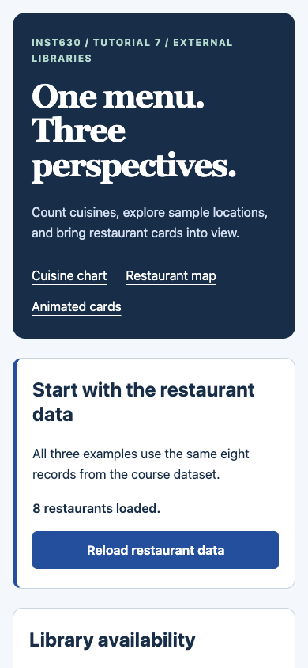
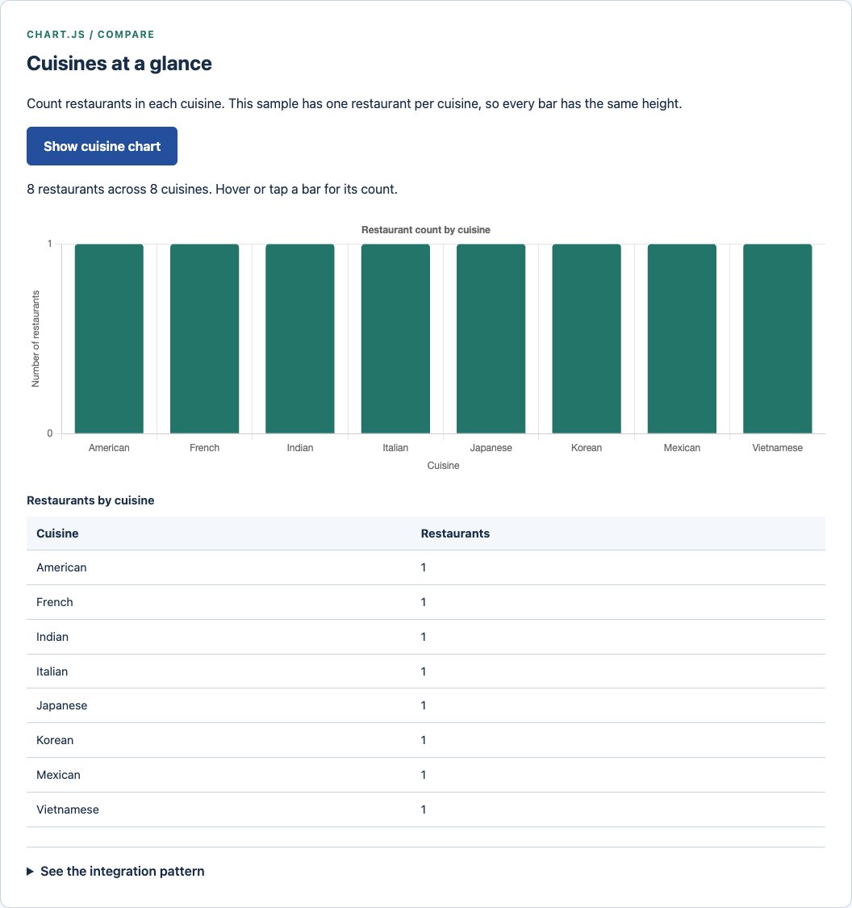
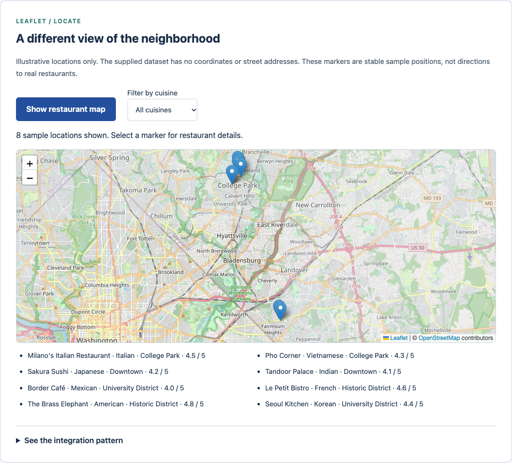
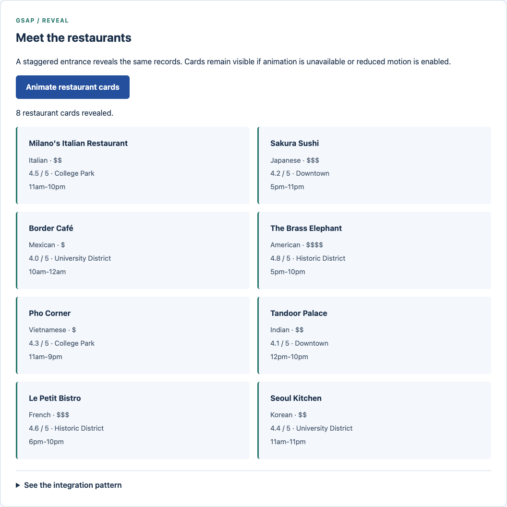

<p align="center"></p>

<p align="center"><strong>Eight restaurants. Three working examples. One shared dataset.</strong><br>Compare cuisines, filter sample locations, and replay a coordinated card entrance.</p>

<p align="center">
  
  
  
  
</p>

<p align="center"><a href="#the-three-examples">Explore the examples</a> · <a href="#class-requirements">Class requirements</a> · <a href="#run-locally">Run locally</a> · <a href="#verification">Verification</a></p>

---

## The project

An INST630 external JavaScript library tutorial built from `tutorial_7_external`. The application loads the supplied restaurant file with `async` / `await`, validates the records, and uses the same data in three different views. Each library follows the same sequence:

**CDN → Check → Process → Initialize → Error handling**

The libraries enhance the page without becoming a single point of failure. A chart has an exact values table, a map has a filtered restaurant list, and animated cards remain readable without GSAP.



<details>
<summary><strong>See the mobile layout</strong></summary>
<br>
<p align="center"></p>
</details>

## The three examples

| Library | Data preparation | Working interaction | Fallback |
| --- | --- | --- | --- |
| **Chart.js** | Count restaurant records by cuisine; sort labels alphabetically | Bar chart with hover and tap tooltips; repeated creation destroys the previous chart | Exact totals in a semantic table |
| **Leaflet** | Filter records by cuisine; derive stable illustrative positions from the supplied neighborhoods | Markers with safe restaurant popups; cuisine filtering; zoom controls | Filtered text list of restaurant names, cuisines, neighborhoods, and ratings |
| **GSAP** | Create one card for each of the eight records | Staggered opacity, position, and scale entrance; replay cancels the earlier animation | Static cards when GSAP fails or reduced motion is enabled |

<details open>
<summary><strong>Cuisine chart</strong></summary>
<br>

</details>

<details>
<summary><strong>Restaurant map</strong></summary>
<br>

</details>

<details>
<summary><strong>Restaurant cards</strong></summary>
<br>

</details>

**These are sample restaurants, not a restaurant directory.** The source file contains no street addresses or coordinates. Map positions are deterministic demonstrations based on the starter's neighborhood centers, with small offsets to separate records. They are labeled as illustrative on the page and in popups. Nearby markers can overlap at the overview zoom; filter by cuisine or zoom in to inspect them. The source JSON is unchanged.

The cuisine chart intentionally shows equal bars: each of the eight supplied cuisines appears once. The counting function also handles repeated categories, which is checked using a separate test fixture rather than altering the course data.

## Class requirements

| Assignment goal | Implementation |
| --- | --- |
| Load restaurant data using async / await | `loadRestaurantData()` checks HTTP status, parses JSON, validates records, and applies a ten second timeout |
| Verify external libraries loaded | `checkAllLibraryStatus()` checks `Chart`, `L.map`, and `gsap.fromTo` and reports availability independently |
| Chart.js cuisine bar chart | `countCuisines()` and `createMyChart()` prepare labels and counts, then call `new Chart()` |
| Leaflet markers and popups | `createMyMap()` adds a feature group to `L.map()` and binds safe DOM content to each marker |
| GSAP smooth card animation | `animateMyCards()` calls `gsap.fromTo()` with duration, stagger, easing, and a visible final state |
| Graceful degradation | Each demo retains text content if its library or initialization fails; tile errors produce separate feedback |
| Project 2 preparation | The comparison below connects each library to data requirements, user tasks, and integration risks |

The downloaded starter labels itself “Tutorial 8” in several places. This repository uses the supplied folder name and the assignment's Tutorial 7 label. The original scaffold, support file, and provided answer are preserved in the first commit. The included `answer/script.js` is course reference material and is not loaded by the application.

## Run locally

The application needs a static HTTP server because it fetches JSON and imports JavaScript modules. Opening the HTML with `file://` will not provide the same behavior.

```sh
python3 -m http.server 8000 --bind 127.0.0.1
```

Open **[localhost:8000/tutorial_7_external/](http://localhost:8000/tutorial_7_external/)**. Select **Load restaurant data**, then try the chart, map, and animation controls. Filter the map to Japanese and select the Sakura Sushi marker. Change back to All cuisines, then replay the cards.

No build step or application package installation is required. The three pinned libraries load from CDNs. Leaflet's stylesheet and marker images also load externally; OpenStreetMap supplies the map tiles. An internet connection is needed for those enhancements. Local restaurant data and text alternatives remain usable if the external scripts fail.

## Verification

For the development checks, use Node.js 22 or newer and Python 3:

```sh
npm ci
npx playwright install chromium
npm run check
npm test
```

To use an installed Chrome browser instead of Playwright's bundled Chromium:

```sh
BROWSER_CHANNEL=chrome npm test
```

| Check | Local result | Scope |
| --- | --- | --- |
| JavaScript syntax and data checks | PASS | Repeated cuisines, total count, empty input, duplicate IDs, missing fields, invalid ratings, stable sample positions |
| Browser regression suite | PASS | Ten scenarios in installed Chrome, including all three demos, repeat actions, popups, filtering, failed requests, invalid responses, timeout, blocked scripts and tiles, initialization errors, and literal text rendering |
| Reduced motion | PASS in automated checks | Static cards and disabled Chart.js animation; this does not establish full motion accessibility |
| Layout and keyboard | PASS in automated checks | No horizontal page overflow at 320, 390, and 1440 pixels; keyboard activation of the load button |
| Screenshot inspection | PASS for captured states | Desktop, mobile, chart, map, and card screenshots are actual browser captures |
| Dependency audit and whitespace | PASS | No known npm vulnerabilities reported; `git diff --check` passed |
| Safari, Firefox, VoiceOver, and complete accessibility review | UNVERIFIED | Not covered by the local checks |
| GitHub Actions | Configured | Hosted execution must be checked after publication |

The suite starts and stops its own server on port 8768. Real CDN availability remains outside this project's control. Expected blocked requests are tested separately from normal operation. A successful automated check is evidence for that scenario, not proof of every browser or assistive technology.

## Choosing a library for Project 2

| Candidate | Use it when | Capability added | Main trade-off |
| --- | --- | --- | --- |
| **Chart.js** | People need to compare counts, ratings, or trends | Tooltips, axes, scales, and responsive charts | Data must be aggregated correctly; canvas needs an equivalent text view |
| **Leaflet** | Verified locations and spatial relationships affect a decision | Interactive geographic display and filtering | Coordinates, tile availability, attribution, and map accessibility require extra work |
| **GSAP** | A coordinated transition explains a state change that CSS cannot easily support | Timing, stagger, easing, and animation control | Motion must stay optional; the library should solve a real interaction need |

**For this dataset, Chart.js is the strongest starting point.** Cuisine and rating already exist, while a reliable Leaflet implementation would first need verified coordinates. A more useful chart extension would compare average ratings by cuisine or restaurant. With only one record per cuisine, category averages would still represent individual sample restaurants, not a broader market trend.

The final Project 2 choice should depend on Assignment 2's actual dataset and user task. This tutorial does not modify that separate assignment. Before choosing, identify the question the library answers, check the required data, build a small prototype, and test a failed library load. Use CSS for simple transitions before adding GSAP.

## Design decisions

The three examples use the same headings, controls, and feedback structure so attention stays on what each library adds. Dark blue identifies navigation and actions; green identifies the examples. A table and a location list expose information that would otherwise depend on the chart or map.

Two patterns from *Designing Interfaces: Patterns for Effective Interaction Design*, 3rd edition, by Jenifer Tidwell, Charles Brewer, and Aynne Valencia support these choices:

- **Alternative Views**, supplied PDF page 180: the same records can support different tasks through substantially different views. Here, counting, locating, and inspecting details use one shared dataset.
- **Animated Transition**, supplied PDF page 334: motion can communicate an action or change. The cards use a brief coordinated entrance after an explicit request, with a static alternative for reduced motion.

These are PDF page positions, not printed page numbers. The patterns support the interaction decisions; they do not establish which JavaScript library should be used.

## Project structure

```text
externalLibraries/
├── tutorial_7_external/
│   ├── index.html             # pinned CDN includes and tutorial interface
│   ├── script.js              # shared state and three library examples
│   ├── tutorial-support.js    # loading, status checks, and safe cards
│   ├── data.js                # validation, cuisine counts, sample positions
│   ├── restaurants.json       # unchanged course dataset
│   ├── instructions.md        # supplied assignment reference
│   └── answer/script.js       # supplied reference, not an application import
├── tests/                     # data and browser checks
├── .github/workflows/         # browser verification on pushes and PRs
├── docs/assets/               # custom banner and actual screenshots
└── package.json               # development scripts and pinned Playwright
```

## Sources

The restaurant data, original scaffold, instructions, and provided answer come from the course's `tutorial_7_external` support files. The implementation follows the official [Chart.js getting started guide](https://www.chartjs.org/docs/latest/getting-started/), [Leaflet quick start](https://leafletjs.com/examples/quick-start/), and [GSAP getting started guide](https://gsap.com/resources/get-started/). The assignment also references [MDN's third party APIs overview](https://developer.mozilla.org/en-US/docs/Learn_web_development/Extensions/Client-side_APIs/Third_party_APIs).

Library versions match the provided starter's examples. Chart.js and Leaflet use permissive open source licenses; GSAP has its own [standard license](https://gsap.com/community/standard-license/). Course materials and third party libraries retain their respective rights. Map attribution stays visible in the interface.

---

## Author

**Kenneth Yeaher**  
MS in Human Computer Interaction  
University of Maryland, College Park  
[](https://www.linkedin.com/in/kennethyeaher/)

`JavaScript` · `Data Visualization` · `Interaction Design`
